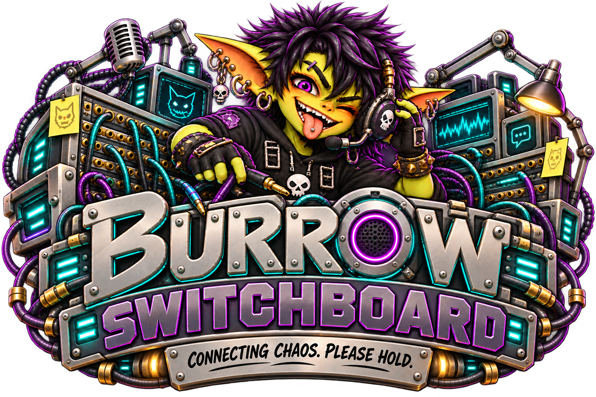

# Burrow Switchboard

**Telegram in. Goblins out.** Switchboard connects approved Telegram chats and forum topics to real Burrow agent sessions. The operator chooses the agent; Core executes the turn; Switchboard returns the completed answer to Telegram.

## Current implementation

This is the first **Telegram-only, text-only** implementation. It uses outbound long polling, not a public webhook, and does not require an inbound reverse-proxy route for Telegram. Unknown chats must be approved before their messages can reach an agent. In groups, an approved route responds only to a bot mention or a reply to the bot.

| Implemented | Not implemented here |
| --- | --- |
| Operator-managed bot token and polling | Discord or another provider |
| Pending admission and per-chat/topic agent mapping | Automatic admission, user-level allowlists, permanent deny list |
| Core external-agent-turn submission and reconciliation | A separate model runner or separate tool execution system |
| Text answers, split into Telegram messages | Attachments, voice, captions, edited messages, streaming replies |
| Durable bounded delivery records and duplicate suppression | Unlimited audit history, manual replay, retry or mapping deletion UI |

An approved group/topic is a shared route: approval is **not** a separate approval of each participant. Choose an agent whose capabilities are appropriate for everyone who can address the bot there. External messages enter the real agent pipeline; approval is not a guarantee that the message is safe or authorized for every tool action.

## Read next

- [Set up Telegram](setup.md)
- [Admission and routing](routing.md)
- [Settings reference](settings.md)
- [Operations and troubleshooting](operations.md)
- [Architecture and Core contract](architecture.md)
- [Mod-local API](api.md)
- [Development, verification and source map](development.md)

## Documentation baseline

These pages describe source version **2026.10.22.1**, implementation commit `b12d6cb2d9aae46542c55b4da12f605ee8009b34`, inspected on **2026-10-22**. They document current implementation, not a promise that the same package is already available in every public channel. Public distribution follows the established next-day synchronization; verify the installed manifest and Core capabilities rather than assuming a package date proves compatibility.

The public website marks Switchboard **Coming soon**. Its documentation can be prepared before the homepage becomes a linked release entry. See the [source map](development.md#source-map) for what supports these pages.

## Pre-publication reconciliation

The source head was rechecked at `056f0749542e92cfe6b2346b6ef7c6f268b5e4e7` (version **2026.10.22.2**). Changes since the implementation baseline only add the selected hero/README image and the automatic release version; runtime behavior is unchanged. This documentation pass preserves that version and makes no runtime changes.
